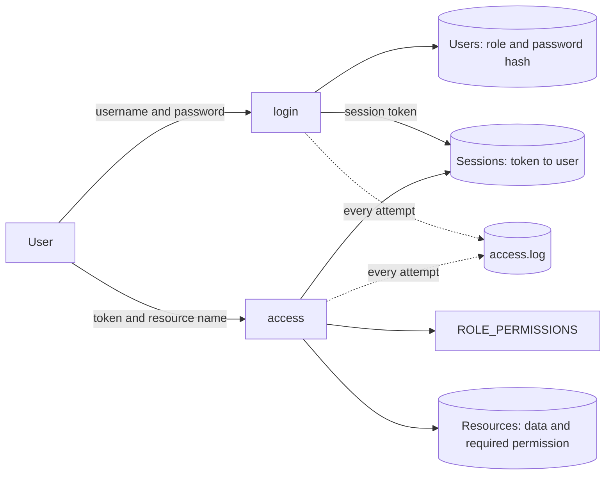

# Threat model: rbac-access-control

**Prepared:** 2026-11-11 · **Method:** STRIDE · **Reviewed:** `rbac.py`, `audit_log.py`, `cli.py` and their tests as they exist in this repository.

Every claim below is tied to the code, a test in this repo, or a measurement described in [Verified findings](#verified-findings). Nothing here is based on assumptions about how the system "should" behave.

## 1. Scope and scoring

**In scope:** user accounts, roles and permissions, the login flow, session tokens, access checks on sensitive resources, the audit log file, and the interactive CLI.
**Out of scope:** the host operating system, network transport (there is none), and any web or API layer that might be added later.

| Scale | Likelihood | Impact |
|---|---|---|
| **Low** | Needs a precondition the current design doesn't provide (for example, guessing a 256-bit random value) | Little or no sensitive data affected |
| **Medium** | Plausible with ordinary access or effort | One user's session, confidential data, or partial loss of accountability |
| **High** | Trivial, or expected in normal use | Secret data, full compromise, or loss of accountability |

Risk = likelihood × impact: Low×Low, Low×Medium and Medium×Low are **Low**; Low×High, Medium×Medium and High×Low are **Medium**; Medium×High, High×Medium and High×High are **High**.

## 2. System map

| Component | What it is | Where |
|---|---|---|
| Users | Username, role, salted PBKDF2 password hash, held in memory | `RBACSystem._users` |
| Roles and permissions | `guest` < `employee` < `manager` < `admin`; each role maps to a set of `read:*` permissions | `ROLE_PERMISSIONS` |
| Resources | Named sensitive data, each requiring one permission | `RBACSystem._resources` |
| Sessions | Random token mapped to a username, held in memory | `RBACSystem._sessions` |
| Audit log | Append-only JSON-lines file (`access.log`) | `audit_log.py` |
| CLI | Login prompt plus `list`, `<resource>`, `logout` | `cli.py` |



**Trust boundary:** everything the user types (username, password, token, resource name) is untrusted. The role is never supplied by the user; it is looked up server-side from the session. The log file sits outside the process and is only as protected as the filesystem around it.

## 3. Threat register (ranked)

| ID | Threat | STRIDE | How it could happen in this code | Likelihood | Impact | Risk |
|---|---|---|---|---|---|---|
| T1 | Credential guessing | Spoofing | `login()` has no lockout or throttling, and the sample accounts and passwords are published in the README and CLI banner | High | High | **High** |
| T7 | Audit log tampering or deletion | Tampering, Repudiation | The log is a plain file with no integrity check; the code doesn't set file permissions (mode `0644` under a typical umask) | Medium | High | **High** |
| T2 | Privilege escalation through unprotected admin functions | Elevation of privilege | `add_user()` and `add_resource()` check no session or role, so any code that can reach them can create an admin | Low | High | **Medium** |
| T3 | Over-permissioned roles | Elevation of privilege, Information disclosure | Roles are cumulative: `manager` reads everything confidential and `admin` reads everything, with no per-resource grants or separation of duties | Medium | Medium | **Medium** |
| T5 | Session theft or replay | Spoofing | Sessions never expire; a stolen token works until logout or process restart | Medium | Medium | **Medium** |
| T6 | Insider misuse | Information disclosure, Repudiation | An authorized `manager` or `admin` reads data they have no business need for; the access is logged but nothing flags it | Medium | Medium | **Medium** |
| T8 | Gaps in the audit trail | Repudiation | Admin operations (`add_user`, `add_resource`) are not logged, and malformed input (non-string token or password) raises an exception before anything is logged | Medium | Medium | **Medium** |
| T10 | Resource exhaustion | Denial of service | Each login attempt costs roughly 50-60 ms of CPU for hashing and appends a log line; there is no rate limit or log rotation | Medium | Medium | **Medium** |
| T4 | Forged or tampered session tokens | Spoofing, Tampering | An attacker edits or invents a token to impersonate a user | Low | Medium | **Low** |
| T9 | Information leaks through errors or the log | Information disclosure | Error messages or the log file reveal which users or resources exist | Medium | Low | **Low** |

Standard-reference mapping (OWASP Top 10, 2021 category names): T2 and T3 fall under *Broken Access Control*; T1 and T5 under *Identification and Authentication Failures*; T7 and T8 under *Security Logging and Monitoring Failures*.

## 4. Existing controls and evidence

Test names are in `test_rbac.py`, `test_cli.py` and `test_threats.py`. Run them with `python -m unittest -v`.

| ID | Controls in place | Evidence |
|---|---|---|
| T1 | Salted PBKDF2-HMAC-SHA256 (200,000 iterations); constant-time comparison; identical error for unknown user and wrong password; dummy hash for unknown users so timing doesn't reveal valid names; CLI exits after 3 failed logins; every failure is logged | `test_wrong_password_blocked`, `test_unknown_user_blocked`, `test_T1_unknown_user_and_wrong_password_are_indistinguishable`, `test_three_failed_logins_exit_with_error`. **Gap:** `test_T1_repeated_failures_lock_the_account` (expected failure) |
| T2 | The CLI exposes only login, list, access and logout; the role comes from the server-side user record and `login()` takes no role argument | `test_unknown_role_rejected`, `test_duplicate_user_rejected`. **Gap:** `test_T2_creating_users_requires_an_authorized_session` (expected failure) |
| T3 | Least-privilege default (`guest` gets only `read:public`); deny by default for unknown roles and resources; permissions defined in one place | `test_guest_limited_to_public`, `test_lower_role_blocked_from_higher_resource`, `test_manager_blocked_from_secret`, `test_unknown_resource_blocked`, `test_T3_unknown_role_gets_no_access`, `test_T3_role_permissions_snapshot` |
| T4 | Tokens come from `secrets.token_urlsafe(32)` and are checked by server-side lookup, so there is no signed content to alter; an edited token is simply unknown | `test_forged_token_blocked`, `test_none_token_blocked`, `test_T4_tampered_tokens_are_rejected_and_logged`, `test_T4_tokens_are_unique_and_long` |
| T5 | Logout invalidates the token; tokens live only in process memory | `test_logout_invalidates_session`. **Gap:** no expiry or idle timeout (sessions store no timestamp) |
| T6 | Every access is recorded with user, resource, outcome and reason | `test_log_records_who_what_and_why`, `test_every_attempt_is_logged`. **Gap:** nothing alerts on or reviews sensitive reads |
| T7 | Entries are only appended; JSON encoding keeps a malicious username from forging extra log lines | `test_T7_log_injection_is_neutralized`, `test_log_persists_across_instances`. **Gap:** no integrity protection; file mode `0644` verified |
| T8 | Every login, logout and access attempt is logged | `test_every_attempt_is_logged`. **Gaps:** `test_T8_user_creation_is_logged` and `test_T8_malformed_token_is_denied_and_logged` (both expected failures) |
| T9 | Generic error messages; passwords and tokens never logged; `list` shows only permitted resources | `test_denial_message_does_not_leak_reason`, `test_passwords_and_tokens_never_logged`, `test_password_never_written_to_log`, `test_accessible_resources_match_role`. **Gap:** the log is world-readable by default and contains usernames and resource names |
| T10 | CLI limits a single run to 3 login attempts | Measurement in F5 below. **Gap:** no per-account or per-source limit |

## 5. Proposed mitigations

| Mitigation | Addresses | Effort | Priority |
|---|---|---|---|
| **M1.** Per-account lockout or exponential backoff after N failures, with lockouts logged; load accounts from configuration instead of shipping sample credentials; add a password length policy | T1 | Medium | **P1** |
| **M2.** Create the log with restrictive permissions (`0600` or `0640`) and verify at startup; add a hash chain (each entry stores the hash of the previous one) so edits are detectable; copy the log to a separate append-only store | T7, T9 | Medium | **P1** |
| **M3.** Add a `manage:users` permission and require an authorized session for `add_user` and `add_resource` | T2 | Small | P2 |
| **M4.** Log all administrative actions (who, what, which role); validate input types at the boundary and deny and log malformed requests. If role changes are ever added, they must log the old and new role | T8 | Small | P2 |
| **M5.** Absolute session lifetime plus idle timeout, with expiries logged; invalidate a user's sessions when their password or role changes | T5 | Small–Medium | P2 |
| **M6.** Replace cumulative roles with narrower functional roles or per-resource grants; review role assignments periodically; keep `test_T3_role_permissions_snapshot` as change detection | T3 | Medium | P2 |
| **M7.** Report or alert on `read:secret` and `read:confidential` access; review the log on a schedule; consider a two-person rule for secrets | T6 | Medium | P2 |
| **M8.** Rate limit logins per account and per source; rotate or cap the log file | T10 | Medium | P2 |
| **M9.** No change needed; keep the token tests as regression protection | T4 | None | P3 |

## Verified findings

Checked by running the code on 2026-11-11 in a clean environment. The four gap tests in `test_threats.py` reproduce F1 to F4.

| # | Finding | Result |
|---|---|---|
| F1 | No lockout in `login()` | 50 consecutive failed logins for `alex`, then the correct password still returned a session |
| F2 | `add_user()` needs no authorization | With no session, `add_user("eve", "pw", "admin")` succeeded and `eve` could then log in; **0** log entries were written |
| F3 | Malformed input is neither denied nor logged | `access()` with a list or dict token raised `TypeError`; `login()` with a `None` password raised `AttributeError`; **0** log entries were written for these attempts |
| F4 | Roles are fixed and hierarchical | `ROLE_PERMISSIONS` gives `admin` all four `read:*` permissions and `manager` three; there is no narrower or per-resource role |
| F5 | Cost per login | Roughly 50-60 ms per failed login in the test environment (two runs: 56 ms and 51 ms; varies by hardware); each attempt also writes one log line |
| F6 | Log file permissions | The log was created with mode `0644` under umask `0022`; the code never sets permissions |

To re-measure F5 (run from the repo folder):

```python
import time
from rbac import AccessDenied, build_sample_system

system = build_sample_system("/tmp/t.log")
n = 5
start = time.perf_counter()
for _ in range(n):
    try:
        system.login("alex", "bad")
    except AccessDenied:
        pass
print(round((time.perf_counter() - start) / n * 1000), "ms per failed login")
```

## Assumptions and limits of this review

- This is a design and code review of a small demonstration system, not a penetration test.
- Likelihood and impact ratings are judgment calls made against the scale in section 1. If your deployment differs (for example, if `add_user` is exposed through a web endpoint), T2 moves from Medium to High.
- No external review or sign-off is recorded here.
